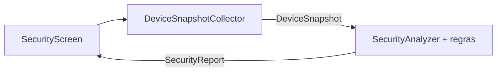

# [NOME DO TIME]: Escudo

> SELDON · Missão 01 · **Trilha B: Cibersegurança**
>
> ⚠️ Missão zero: troque `[NOME DO TIME]` pelo nome do time (tema de videogame) e avise a coordenação.


## O problema

**Cenário.** A maioria das pessoas não sabe se o próprio celular está configurado de forma segura. Sem bloqueio de tela, com depuração USB esquecida ligada ou com meses sem atualização de segurança, o aparelho fica exposto a roubo de dados, golpes e malware. Essas informações existem, mas estão espalhadas em menus técnicos.

**Público.** Usuários comuns de Android, sem conhecimento técnico de segurança.

**Requisitos**
- RF01: Verificar bloqueio de tela, depuração USB, opções do desenvolvedor, idade do patch de segurança, indícios de root e versão do Android.
- RF02: Exibir uma nota de 0 a 100 e um nível (Seguro, Atenção, Crítico).
- RF03: Para cada risco, mostrar uma orientação de correção em linguagem simples.
- RNF01: Não pedir nenhuma permissão e não enviar dados para fora do aparelho.
- RNF02: Análise concluída em menos de 1 segundo.
- RNF03: Interface acessível via leitor de tela (TalkBack).

**Limites.** O app diagnostica e orienta, mas não corrige configurações sozinho. A detecção de root é heurística (ver [limitações](docs/architecture.md#limitações-conhecidas)).

**Métrica de sucesso.** 100% das regras de segurança cobertas por testes automatizados (casos positivo, negativo e de limite) e verificadas no CI a cada PR.

## Arquitetura

Dois módulos: `core/` (Kotlin puro, regras e contratos) e `app/` (Android, coleta e interface).



- Detalhes: [docs/architecture.md](docs/architecture.md)
- Decisão principal: [ADR-001: regras em módulo Kotlin puro](docs/decisoes/ADR-001-core-kotlin-puro.md)

## Como executar

Requisitos: JDK 17 e Android SDK (ou Android Studio).

```bash
./gradlew assembleDebug          # gera app/build/outputs/apk/debug/app-debug.apk
./gradlew :core:test             # testes das regras
./gradlew :app:testDebugUnitTest # testes do app
./gradlew installDebug           # instala no aparelho/emulador conectado
```

## Estratégia de branches

- **`main`**: base estável. Sem commits diretos.
- **`develop`**: integração do trabalho revisado.
- **`feature/*`**: uma tarefa por branch, criada a partir de `develop`.
- Todo PR vai para `develop`, precisa de **1 revisão aprovada e CI verde** para o merge.
- `develop` → `main` só por PR revisado, ao fechar uma entrega.

## Testes e CI

- O que é testado: [docs/testes.md](docs/testes.md)
- O pipeline (`.github/workflows/ci.yml`) roda em todo PR para `develop`/`main` e em push para `develop`:
  1. **Build**: `assembleDebug`
  2. **Testes**: `:core:test` e `:app:testDebugUnitTest`
  3. **Relatório**: APK e relatórios de teste publicados como artefatos da execução
- Resultados: aba **Actions** do repositório.

## Contribuições

| Membro | Papel | O que fez | Evidências |
|---|---|---|---|
| @itsdrews | Líder | Criou o repositório, configurou branches e revisou PRs | PR #… |
| @… | Backend | … | PR #… |
| @… | Frontend | … | PR #… |
| @… | QA | … | PR #… |

> Contribuições sem link (commit, issue ou PR) não são reconhecidas.

## Apresentação

- **Apresentador(a):** …
- **Data:** sexta-feira, 20/11
