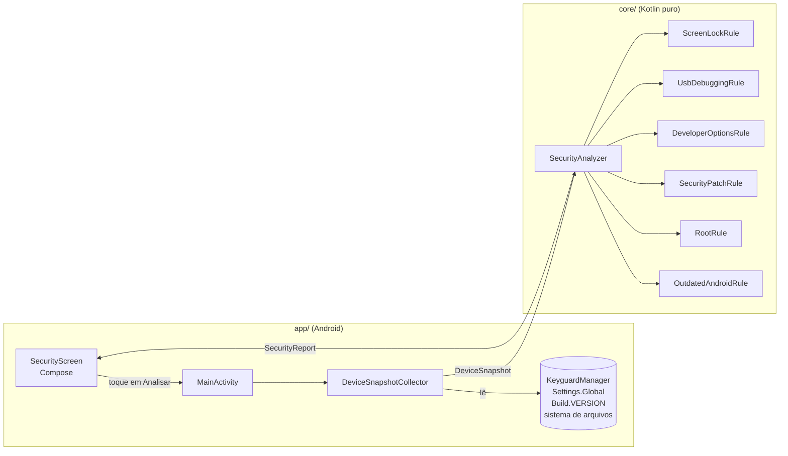

# Arquitetura: Escudo

## Visão geral

O Escudo tem dois módulos com responsabilidades separadas:

| Módulo | Tipo | Responsabilidade |
|---|---|---|
| `app/` | Android (Compose) | Coleta o estado do aparelho via APIs do Android e exibe o relatório |
| `core/` | Kotlin puro (JVM) | Regras de segurança, cálculo da nota e contratos (`DeviceSnapshot`, `Finding`, `SecurityReport`) |

O `app` depende do `core`; o `core` não conhece o Android. A justificativa está no [ADR-001](decisoes/ADR-001-core-kotlin-puro.md).

## Diagrama

## Fluxo de dados

1. O usuário abre o app ou toca em **Analisar novamente**.
2. `DeviceSnapshotCollector` lê o estado do aparelho e monta um `DeviceSnapshot`.
3. `SecurityAnalyzer` passa o snapshot por todas as regras (`SecurityRule`). Cada regra devolve um `Finding` ou `null`.
4. A nota é `100 - soma dos pesos` (mínimo 0). Achado `CRITICAL` força o nível CRÍTICO.
5. `SecurityScreen` mostra a nota, o nível e os achados ordenados por gravidade.

## Regras e pesos

| Regra | Condição | Gravidade (peso) |
|---|---|---|
| Bloqueio de tela | Aparelho sem PIN, senha ou biometria | HIGH (30) |
| Depuração USB | `ADB_ENABLED = 1` | HIGH (30) |
| Opções do desenvolvedor | `DEVELOPMENT_SETTINGS_ENABLED = 1` | LOW (5) |
| Patch de segurança | > 90 dias: MEDIUM (15); > 180 dias: HIGH (30); ilegível: MEDIUM | |
| Root | Binário `su` encontrado em caminhos conhecidos | CRITICAL (60) |
| Android sem suporte | `SDK_INT < 31` | MEDIUM (15) |

Para adicionar uma regra: implemente `SecurityRule` no `core`, registre em `defaultRules()` e escreva o teste em `RulesTest`.

## Decisões de segurança

- **Nenhuma permissão no manifesto.** O app só lê configurações públicas. Menos permissões, menos superfície de ataque.
- **Sem rede e sem armazenamento.** Nenhum dado sai do aparelho nem é gravado. Não há dado pessoal a vazar.
- **`allowBackup="false"`.** Evita extração de dados do app via backup do ADB.

## Limitações conhecidas

- **A detecção de root é heurística.** Ferramentas como Magisk escondem o binário `su`, então um resultado negativo não garante que o aparelho não tem root. Uma evolução seria a Play Integrity API.
- **O limite de SDK 31 é uma suposição** sobre quais versões ainda recebem correções. Deve ser revisado periodicamente.
- **Fabricantes podem não preencher `SECURITY_PATCH`** corretamente. Nesse caso, a regra reporta "data desconhecida".
